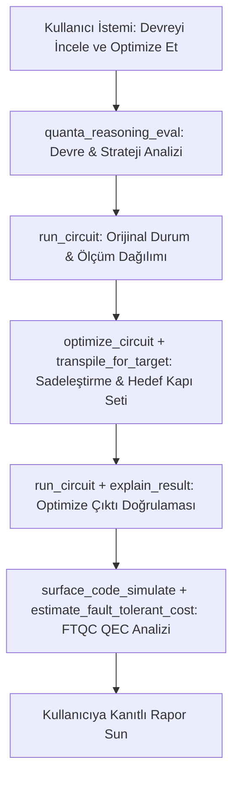

# 🤖 AI Ajanları ile Kuantum Devre Denetimi & Quanta MCP

*Quanta MCP (Model Context Protocol) ile Otonom Devre Analizi, Transpilasyon ve Hata İyileştirme*

---

> **Bu tutorialda öğrenecekleriniz:** MCP (Model Context Protocol) destekli otonom yapay zeka ajanlarının Quanta SDK'nın **25 adet** kuantum aracını kullanarak kuantum devrelerini nasıl otonom olarak denetlediğini, sadeleştirdiğini, uniter eşdeğerliğini matematiksel olarak doğruladığını ve gürültülü donanımlar için FTQC / QEC maliyet analizini gerçekleştirdiğini inceleyeceksiniz.

---

## Kuantum Bilişimde Ajanik Devrim (Agentic Quantum Workflows)

Kuantum devre tasarımı ve derlemesi (transpilation) yüksek seviyeli optimizasyon kararları gerektirir:
- Ham algoritmalar genellikle çok fazla iki-qubit kapısı içerir (yüksek donanım hata payı).
- Donanım kısıtlamaları (kuplaj grafı, yerel kapı setleri) hedef mimariye özel derleme gerektirir.
- Hata düzeltme kodları (Surface Code, Gross qLDPC) fiziksel qubit ek yükü getirir.

**Model Context Protocol (MCP)**, LLM tabanlı yapay zeka ajanlarının yerel veya buluttaki araçları standart bir JSON-RPC arayüzü üzerinden keşfetmesini ve güvenle çağırmasını sağlar. Quanta SDK, kuantum simülasyonundan donanım çalıştırmaya ve FTQC analizine kadar **25 adet gerçek MCP aracı** sunar.

---

## Adım 1: Quanta MCP Sunucusunu Başlatma

Quanta MCP sunucusu `fastmcp` tabanlı olup hem yerel komut satırından (`python -m quanta.mcp_server`) hem de AI istemcilerinden (Claude Desktop, Cursor vb.) doğrudan başlatılabilir:

```bash
# MCP sunucusunu stdio modunda başlatma
python -m quanta.mcp_server

# Veya FastMCP ile Claude Desktop'a kaydetme
fastmcp install quanta/mcp_server.py --name "Quanta Quantum SDK"
```

Claude Desktop konfigürasyonunuza (`claude_desktop_config.json`) doğrudan şu tanımı da ekleyebilirsiniz:

```json
{
  "mcpServers": {
    "quanta": {
      "command": "python",
      "args": ["-m", "quanta.mcp_server"]
    }
  }
}
```

---

## Adım 2: Ajanın Kullandığı Gerçek MCP Araçları

Bir AI ajanı devre denetimi ve optimizasyonu yaparken `quanta.mcp_server` içindeki aşağıdaki gerçek araçları zincirleme çağırır:

| MCP Aracı | Görevi | Ajanın Kullanım Amacı |
|---|---|---|
| `quanta_reasoning_eval` | Devre yapısını ve karar alternatiflerini bilişsel Zeno hakemiyle değerlendirir. | Mimari darboğazları ve optimizasyon stratejisini belirlemek. |
| `optimize_circuit` | Ters kapı iptali (`CancelInverses`) ve rotasyon birleştirme (`MergeRotations`) uygular. | Gereksiz kapıları ve devre derinliğini azaltmak. |
| `transpile_for_target` | Devreyi hedef donanım kapı setine (`ibm_heron`, `ionq_aria`, `google_sycamore`) çevirir. | Donanım uyumlu yerel kapı dizisi üretmek. |
| `run_circuit` / `explain_result` | Devreyi simüle eder ve ölçüm dağılımını yapılandırılmış olarak yorumlar. | Optimizasyon öncesi ve sonrası çıktıları doğrulamak. |
| `surface_code_simulate` / `estimate_fault_tolerant_cost` | Surface code hata bastırmasını simüle eder ve FTQC fiziksel qubit maliyetini hesaplar. | Gürültülü donanım için hata toleransı bütçesini çıkarmak. |

---

## Adım 3: Otonom Devre Denetimi Senaryosu

Bir yapay zeka ajanının kullanıcıdan gelen bir Bell durumu devresini denetleme, derleyici geçişleriyle sadeleştirme ve durum vektörü sadakatini ($F = |\langle\psi_{\text{raw}}|\psi_{\text{opt}}\rangle|^2$) doğrulama adımlarını Python üzerinden modelleyelim:

```python
import numpy as np
from quanta import circuit, H, CX, X, measure, run
from quanta.dag.dag_circuit import DAGCircuit
from quanta.compiler.pipeline import CompilerPipeline
from quanta.compiler.passes.optimize import CancelInverses

# 1. Kullanıcının oluşturduğu gereksiz kapılar içeren ham devre
@circuit(qubits=2)
def raw_circuit(q):
    H(q[0])
    H(q[0])  # Gereksiz H-H iptali
    H(q[0])
    CX(q[0], q[1])
    X(q[1])
    X(q[1])  # Gereksiz X-X iptali
    return measure(q)

@circuit(qubits=2)
def optimized_circuit(q):
    H(q[0])
    CX(q[0], q[1])
    return measure(q)

dag = DAGCircuit.from_builder(raw_circuit.build())
print(f"Ham Devre Kapı Sayısı: {dag.gate_count()}")

# 2. AI Ajanının optimize_circuit (CancelInverses) motorunu devreye sokması
pipeline = CompilerPipeline([CancelInverses()])
optimized_dag = pipeline.run(dag)
print(f"Optimize Edilmiş Devre Kapı Sayısı: {optimized_dag.gate_count()}")

# 3. Fidelity (Sadakat) Doğrulaması: Durumların %100 eşdeğer olduğunu kanıtlama
res_raw = run(raw_circuit, shots=500, seed=42)
res_opt = run(optimized_circuit, shots=500, seed=42)

psi_raw = res_raw.statevector
psi_opt = res_opt.statevector

fidelity = float(abs(np.vdot(psi_raw, psi_opt)) ** 2)
print(f"Matematiksel Fidelity (Eşdeğerlik): {fidelity:.6f}")
assert np.isclose(fidelity, 1.0)
print("✅ Ajan Kararı: Devre optimizasyonu semantik hiçbir kayıp olmadan %100 başarıyla tamamlandı!")
```

---

## Adım 4: MCP Tool Çağrı Döngüsü (Agent Loop)

Aşağıdaki akış diyagramı, bir LLM ajanının gerçek Quanta MCP araçları ile gerçekleştirdiği otonom denetim döngüsünü özetler:



---

## Özet & Kazanımlar

- **Standart Protokol (`python -m quanta.mcp_server`)**: 25 gerçek MCP aracı sayesinde AI asistanları doğrudan kuantum simülatörünüzle konuşabilir.
- **Güvenli Optimizasyon**: `optimize_circuit` ve `transpile_for_target` sonrası simülasyon ve fidelity kontrolü, doğruluğu matematiksel olarak teminat altına alır.
- **Donanıma ve FTQC'ye Hazırlık**: AI ajanları mantıksal devreyi donanım kapı setine uydururken `surface_code_simulate` ve `estimate_fault_tolerant_cost` ile hata düzeltme gereksinimlerini hesaplar.
